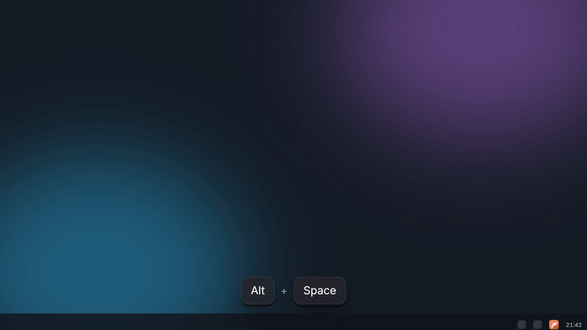
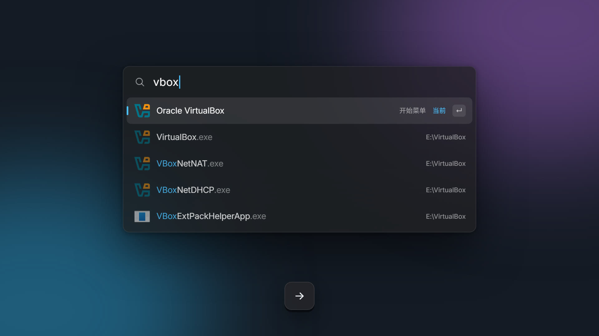
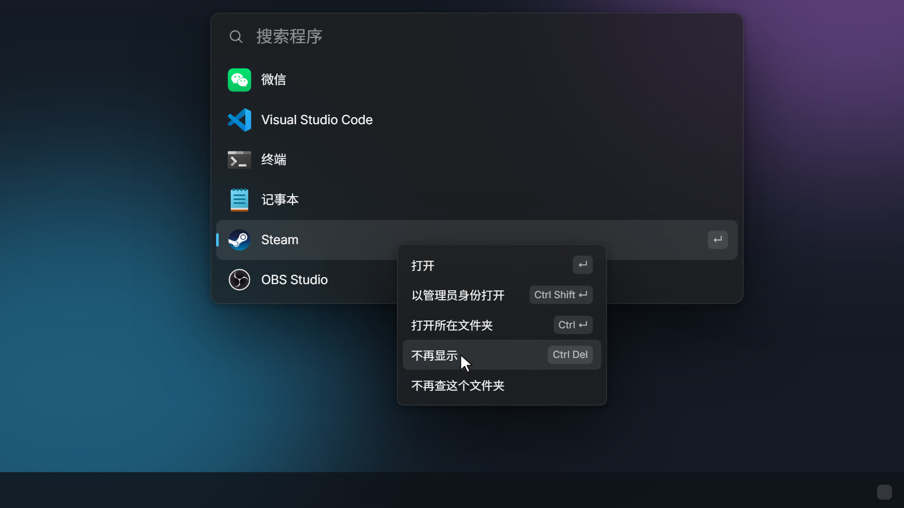
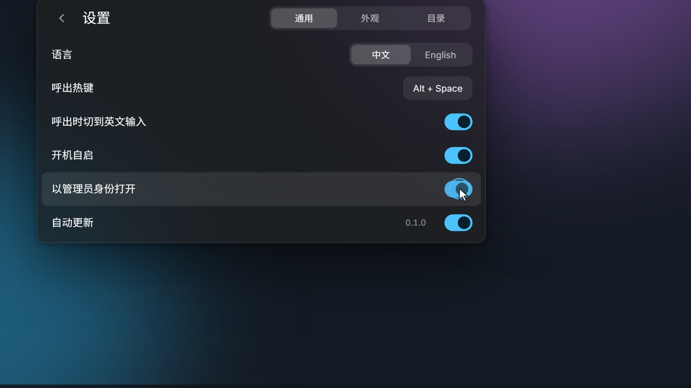
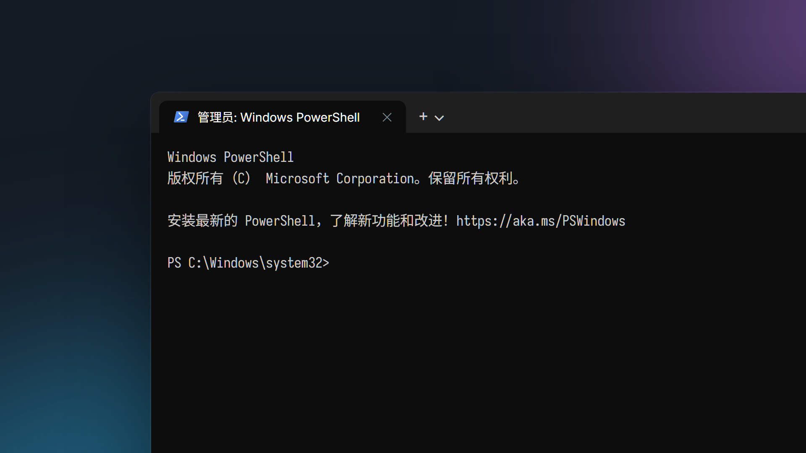

# frun

[中文](README.zh-CN.md)

A program launcher for Windows. Press Alt + Space, type a few letters, press Enter.



frun looks for programs and nothing else. It finds them wherever they live: the Start menu, the Microsoft Store, and the small tools you keep in folders like `D:\Tools` that never made it into the Start menu. It does not search your documents.

## What it does

**Type a name, or the first letters of its pinyin.** `wx` finds 微信 (WeChat), `vsc` finds Visual Studio Code. Enter opens the top row; Alt + a number opens that row.

**One program, one row.** A program folder often holds a dozen exes: the app, its updater, crash reporters, helpers. frun shows the program once and keeps the rest behind it. Press → to see them.

**Paths work too.** Type `d:\so`, press Tab to complete, keep typing, press Enter, and the folder opens in Explorer.

**Right-click for the rest.** Open as administrator, open the containing folder, hide a program you never want to see again (Ctrl + Z brings it back), or stop searching a folder.

<p>


</p>
<p>


</p>

**Open everything as administrator, if you want.** Turn on *Open as administrator* in Settings → General and every program you start from frun runs elevated. Windows still asks each time, as it should. frun itself never asks for administrator rights. Microsoft Store apps are left alone, because Windows does not let them run elevated this way.

<p>


</p>

**Nothing to set up.** On first run frun reads the install records Windows keeps, works out which folders hold your programs, and adds them. When you install something new, it shows up on its own.

**Light and dark.** It follows the Windows theme, or you can pick one. It also follows the screen your mouse is on.

## Keys

| Key | What it does |
| --- | --- |
| Alt + Space | Show or hide (you can change it in Settings) |
| Enter | Open |
| Alt + 1 … 8 | Open that row |
| → | Show the other exes in a program's folder (← folds them back); accept a path completion |
| Tab | Accept a path completion; otherwise move to the next row |
| Ctrl + Shift + Enter | Open as administrator |
| Ctrl + Enter | Open the containing folder |
| Ctrl + Delete | Hide this program; Ctrl + Z to undo |
| Ctrl + , | Settings |
| Esc | Back, or hide |

## Light

One exe of about 2 MB. No installer, no runtime, no web view. On the author's machine, with 1,603 programs indexed:

- a search takes about 0.25 ms per keystroke;
- three seconds after it hides, it holds about 0.4 MB of physical memory.

## Getting it

There is no release yet. Until there is, build it yourself: you need Windows 10 or 11 and [Rust](https://rustup.rs).

```
cargo build --release
```

Put `target/release/frun.exe` anywhere you like and run it. Turn on *Launch at startup* in Settings if you want it there after a restart.

## Your data

Settings and usage counts live in `%APPDATA%\frun`; the index and icon cache live in `%LOCALAPPDATA%\frun` and can be deleted at any time. frun sends nothing anywhere. Its only network request is a check of this repository's Releases page, at most once a day, for a newer version. You can turn that off in Settings.

If frun misses a program or shows one it shouldn't, run `frun --doctor`. It writes a report to `%LOCALAPPDATA%\frun\doctor.txt` and opens it. The report lists folder and program paths from your computer, so read it before you attach it to an issue.

## License

MIT, see [LICENSE](LICENSE). The interface font is a subset of Sarasa Gothic under the SIL Open Font License 1.1, see [assets/FONT-NOTICE.md](assets/FONT-NOTICE.md).
